# Form factors and edges: what users see, down to the screen edge

**Status:** report, 2026-11-04. **Authors:** Clare (Part A, iPhone and iPad, simulators) and QTest (Part B, Android emulators; this summary).
**Build tested:** `agentmux-mobile` build 28 (`0.2.0+28`, main `a58c723`), demo data only. The screens use the app's demo fleet and made-up computers; no real fleet is shown.

**The ask:** "On ios, I notice the curved bottom of the screen should be filled in with status information. in fact, the duo and other form factors need to be considered. can you have the macos prepare a report that covers all form factors, and we want a document with previews showing what users see, down to the edges. Edges are often where glitchy user experiences come from, make sure they are filled in gracefully, research best practices and support the OS's color mode".

## 0. The answer in one page

**What was covered**

| | Devices | Result |
|---|---|---|
| iPhone | 39 simulator models in total: SE 2/3, XR, XS, 11 to 17e, minis, Plus, Pro, Pro Max, Air; portrait and landscape; dark and light; Dynamic Type XXXL and AX5 | Part A |
| iPad | mini, Pro 11", Pro 13", full screen and as an iPadOS 26 window | Part A |
| Android phone | Pixel 9 (1080x2424), gesture and three-button navigation, portrait and landscape, dark and OS-light, a 320 dp width at the largest font | Part B |
| Android foldable | Pixel Fold closed (outer 1080x2092), open (inner 2208x1840), half-open | Part B |
| iPhone Duo (Apple's new foldable) | **Not captured**: the build Mac has Xcode 26.6 only, which has no foldable simulator. The Duo section uses Apple's own documentation. Capturing it needs macOS 26.6+ and Xcode 27.1/27.2 with the iOS 27 runtime | Part A, last section |
| iPad Split View tiles and Slide Over | **Not captured** (needs gestures the Mac harness cannot drive); the report says how to get them | Part A |
| Android tablet (10"), Android 16, Surface Duo | **Not captured** (the unfolded Pixel Fold stands in for a tablet: same width class); Surface Duo is not covered | Part B |

**The curved bottom of the iPhone.** It is an empty band today: 34 pt in portrait and 20 pt in landscape on every Face ID iPhone (25 pt on iPads), under the "MuxBus Sign in" bar. **Recommendation: design A**, one line of muted status text in that band, either side of the home indicator ("LAN, 3 computers" on one side, "3 working" on the other), falling back to **design B**, a status row on top of the bar, where there is no band (iPhone SE, the Duo's outer display, landscape on small phones). Mockups of A, B and C are in Part A, section 6.

**Defects, both platforms.** I prefix iOS with I and Android with A.

| # | What | Where | Severity |
|---|---|---|---|
| I1 | The curved bottom is an empty band; lists scroll into it | every Face ID iPhone, every iPad | the status-band ask |
| I2 | Lists ignore side insets in landscape: cards and text run under the notch or Dynamic Island, timestamps cut off | every Face ID iPhone in landscape | major |
| I3 | The snackbar is Material's white full-width slab across the curved bottom | all | medium |
| I4 | "Connect manually" overflows in landscape with the keyboard up | every iPhone in landscape | major (the button is unreachable) |
| I5 | DEMO banner stops short of the edges in landscape and overflows at large text | demo screens | minor |
| I6 | Light mode is identical to dark: the app ignores the OS color mode | all | **major** (the ask) |
| I7 | At the largest accessibility text, names truncate to "s...", badges wrap, the banner and landscape feed overflow | Dynamic Type AX sizes | medium |
| I8 | No wide layout: iPad is a stretched phone column | iPad, iPhone Duo inner display | **major** |
| I9 | On iPadOS 26 the app opens as a window and the window controls hide the back arrow on every pushed screen | all iPads | **major** (navigation hidden) |
| A1 | List content slides under the gesture pill with no scrim | all Android phones | minor |
| A2 | In landscape the pinned sign-in bar and top bar leave a strip of content; insets unequal | Android phones | **major** |
| A3 | No light theme; OS light ignored | all Android | **major** (the ask) |
| A4 | Phone layout stretched across 600 dp and up: names at the far left, badges 1,400 px away | Pixel Fold open, tablets | **major** |
| A5 | No hinge awareness when half-open | foldables | minor |
| A6 | App-bar title truncates to "Agen..." at 320 dp with the largest font | small phones, big text | minor |
| P1 | **No UIScene adoption:** any Xcode 27 build (required for the Duo) fails to launch (Apple TN3187) | iOS | blocker for the Duo and for Apple's next SDK deadline |

I1 to I9, A1 to A6 are in the two parts with screenshots and the Flutter fix for each. I1/A1, I2/A2, I6/A3, I8/A4 and I7/A6 are the same problem on both platforms, so one fix each.

## 0.1 The fix PRs this leads to (one change, both platforms, in this order)

1. **Safe areas and insets (I1, I2, I4, I5, A1, A2).** One inset strategy: lists get `MediaQuery.paddingOf` in their explicit padding (four places), backgrounds run to the edge, content stays inside; the landscape sign-in bar moves out of a pinned bar; the manual-add sheet scrolls above the keyboard.
2. **The bottom status band (I1), design A with B as the fallback** (needs the safe-area PR's inset helper).
3. **OS color mode (I6, A3) and the snackbar (I3):** a light `ThemeData` from the same `ColorScheme` roles, `themeMode: ThemeMode.system`, an adaptive launch screen, status-bar style from the theme, and a floating, themed snackbar.
4. **Adaptive layout (I8, A4, A5, I9):** width classes at 600 and 840 (a rail, then list-detail with computers and agents beside the feed), window-control inset on iPad windows, hinge/fold awareness (`displayFeatures` on Android; UIKit's reserved regions on the Duo).
5. **Large text (I7, A6):** rows wrap, fixed chrome clamps its scale.
6. **UIScene migration (P1):** required before any Xcode 27 build; Flutter 3.41 does it automatically, the app pins 3.38.9, so this rides a Flutter upgrade. Do it before the Duo work.

Fixes 1 and 3 come first (the status band and the OS color mode were the two explicit asks), then 2 on top of 1.

**Open decisions:** (1) design A, B or C for the bottom status; (2) whether to set up Xcode 27 for iPhone Duo captures; (3) whether the two-pane layout (list-detail) is wanted on iPad and foldables or only wider columns.

**How to read the images.** Part A's images are in `form-factors/apple/deliver/`: `originals/` are the real screens with the display's corners, notch and island drawn in black; `insets/` are the same with the safe areas marked (red top and side insets, magenta bottom, cyan the safe rectangle, yellow the keyboard). Part B's images are in `form-factors/android/`.

---

# Part A: iPhone and iPad (Apple)

*By Clare. Section numbers inside Part A refer to Part A; defect numbers are renamed I1 to I9.*

## 1. Summary

**What people see today.** The app is one dark phone column on every Apple device. The top bar's colour reaches the corners and the Dynamic Island everywhere, and the status bar reads well in both appearances. The edges go wrong in nine ways, roughly ranked by how many people see them:

| # | Edge defect | Where | Fix (Flutter) |
|---|---|---|---|
| I1 | **The curved bottom is an empty band** (34 pt in portrait, 20 pt in landscape) under the "MuxBus Sign in" bar, and the demo fleet's last cards scroll into it | every Face ID iPhone (32 of the 34 iPhone types measured), every iPad (25 pt) | fill it with status (section 6); give scrolling lists the bottom inset |
| I2 | **Lists ignore the safe area in landscape**: cards and feed text run under the Dynamic Island or notch, and timestamps are cut off | every Face ID iPhone in landscape (side insets 44 to 68 pt) | an explicit `ListView(padding:)` turns off Flutter's automatic safe-area padding: add `MediaQuery.paddingOf(context)` to it (4 places) |
| I3 | **The snackbar is a bright white full-width slab** that fills the curved bottom and its corners | all devices, both appearances | `SnackBarThemeData(behavior: SnackBarBehavior.floating, backgroundColor: AppColors.surfaceVariant, ...)` |
| I4 | **"Connect manually" sheet overflows in landscape with the keyboard up** ("BOTTOM OVERFLOWED BY 69 PIXELS") | every iPhone in landscape | scrollable sheet body, `padding: EdgeInsets.only(bottom: MediaQuery.viewInsetsOf(context).bottom)`, `useSafeArea: true` |
| I5 | **The yellow DEMO banner stops short of the edges in landscape**, and overflows at large text | demo screens; landscape; accessibility text sizes | paint it full width outside the inset, inset only its text; size it from the text scaler |
| I6 | **The app ignores the OS colour mode**: in Light mode it looks exactly as in Dark (status bar, keyboard, sheets, launch screen) | all devices | a light theme + `themeMode: ThemeMode.system`; adaptive launch-screen colour |
| I7 | **The largest text sizes break the chrome**: host names shrink to "s…", the LAN badge wraps to "LA/N", "MuxBus" splits, the feed overflows in landscape | Dynamic Type AX sizes (×3.1) and XXXL (×1.35) | let rows wrap; clamp only fixed chrome (`MediaQuery.withClampedTextScaling`) |
| I9 | **On iPad as a window, the window controls cover our top-leading corner**: the back arrow is hidden on every pushed screen, and the "AgentMux" title is partly covered | iPadOS 26 Windowed Apps / Stage Manager (all iPads) | pad the AppBar's leading edge by the window-control area (UIKit corner-adapted margins), section 4.4 |
| I8 | **No layout for wide windows**: on iPad, a single list stretched to 1032 or 1376 pt; nothing adapts to a Split View tile, Slide Over or a window | iPad (all sizes), iPhone Duo inner display | list-detail at ≥ 840 pt wide (computers and agents on the left, the feed on the right), rail at ≥ 600 |

Two platform items sit underneath all of this:
- **UIScene life cycle isn't adopted** (`Info.plist` has no `UIApplicationSceneManifest`). Apple's TN3187: apps built with the iOS 27 SDK that haven't migrated "fail to launch". That's required before any Xcode 27 build, so before any iPhone Duo work. Flutter 3.41 migrates eligible apps automatically; the app pins 3.38.9.
- **The iPhone Duo can't be tested on the build Mac yet** (only Xcode 26.6 is installed; see the Duo section).

**Recommendation for the status band:** design **A**, status in the home-indicator band, with **B** (a status row on top of the bottom bar) wherever there is no band (iPhone SE, Duo outer display). Mockups and reasons in section 6.

## 2. How this was captured

- **The real app**, driven by a local Flutter integration test  that taps through it on each simulator, logs Flutter's `MediaQuery` values for every capture, and holds each screen until `xcrun simctl io screenshot --mask=black` has taken it. The **mask** draws the display's real rounded corners, notch and Dynamic Island in black, so the PNGs show what a person sees down to the edges (a plain simulator screenshot is a full rectangle).
- **Fictional data only**: the discovery screen gets three made-up computers (studio-mac, build-box, office-pc) and agents (Nova, Orion, ...), so no capture shows our real fleet. The demo fleet is the app's own demo.
- **Feed with the composer**: a real feed needs a paired computer, so that capture is the real `SendPanel` (the composer) under a stand-in transcript, with the real system keyboard up. The edge behaviour of the transcript list is checked in the code (I2).
- **Status bar** fixed at 9:41, full bars, charged battery. Each run reboots its simulator; camera access is pre-granted, so the QR screen shows the Simulator's "no camera" view.
- **Orientation**: iPhones turn the app with `SystemChrome.setPreferredOrientations`. iPadOS ignores that, so for iPad landscape a small XCUITest turns the simulated device first (`XCUIDevice.shared.orientation`), then the app follows it on its own, as it would in a person's hand.
- **iPad windows**: the simulators showed AgentMux both full screen and as an iPadOS 26 window (section 4.4); both are captured. Arranging tiles (Split View, Slide Over) needs gestures this Mac can't drive (no Accessibility permission), so tiles weren't captured (section 4.5).
- **Each capture has two files**: `originals/` (full size) and `insets/` (the same with the safe areas marked: red is the top and side insets, magenta the bottom/home-indicator inset, cyan outlines the safe rectangle, yellow the keyboard, and a caption gives the numbers in points).

### What was run

| Set | Devices | Orientations | Appearances | Screens |
|---|---|---|---|---|
| Main matrix | iPhone SE (3rd gen), 16e, 17, 17 Pro Max, Air; iPad mini (A17 Pro), iPad Pro 11" (M5), iPad Pro 13" (M5) | portrait and landscape | dark and light | discovery (first screen), its ⋮ menu, "Connect manually" sheet with keyboard, demo fleet (top and scrolled to the end), demo agent, snackbar, feed, feed with keyboard, Settings, MuxBus sign-in, QR scan, launch frames |
| All iPhones | every other iPhone type the installed runtimes accept: iPhone 11 to 17e incl. mini, Plus, Pro, Pro Max, SE 2 (iOS 26.5), XS, XS Max, XR (iOS 18.2) | portrait and landscape | dark | discovery, demo fleet scrolled to the end, feed with keyboard |
| Dynamic Type | iPhone SE 3, iPhone 17 Pro Max | portrait and landscape | dark | XXXL (largest standard) and AX5 (largest accessibility) |
| Mockups | iPhone 17 Pro Max, iPhone SE 3, iPad Pro 11" | portrait (and landscape) | dark | designs A, B, C on discovery and the demo fleet |
| iPad landscape | iPad mini, Pro 11", Pro 13", the device turned by XCUITest (the app opened as a window) | landscape | dark and light | as the main matrix |

## 3. Device geometry (measured)

What Flutter's `MediaQuery.viewPadding` reported on each simulator, in points. Portrait: T = status bar/notch/island, B = home indicator. Landscape: L/R = the notch or island side (iOS reports both sides), B = home indicator, and no status bar.

| Device | Points (portrait) | Scale | Safe area portrait | Safe area landscape |
|---|---|---|---|---|
| ipad-mini | 744 × 1133 | @2x | T32 B25 L0 R0 | T10 B10 L0 R0 |
| ipad-pro-11 | 834 × 1210 | @2x | T32 B25 L0 R0 | T32 B20 L0 R0 |
| ipad-pro-13 | 1032 × 1376 | @2x | T32 B25 L0 R0 | T10 B10 L0 R0 |
| iphone-11 | 414 × 896 | @2x | T48 B34 L0 R0 | T0 B20 L48 R48 |
| iphone-11-pro | 375 × 812 | @3x | T44 B34 L0 R0 | T0 B20 L44 R44 |
| iphone-11-pro-max | 414 × 896 | @3x | T44 B34 L0 R0 | T0 B20 L44 R44 |
| iphone-12 | 390 × 844 | @3x | T47 B34 L0 R0 | T0 B20 L47 R47 |
| iphone-12-mini | 375 × 812 | @3x | T50 B34 L0 R0 | T0 B20 L50 R50 |
| iphone-12-pro | 390 × 844 | @3x | T47 B34 L0 R0 | T0 B20 L47 R47 |
| iphone-12-pro-max | 428 × 926 | @3x | T47 B34 L0 R0 | T0 B20 L47 R47 |
| iphone-13 | 390 × 844 | @3x | T47 B34 L0 R0 | T0 B20 L47 R47 |
| iphone-13-mini | 375 × 812 | @3x | T50 B34 L0 R0 | T0 B20 L50 R50 |
| iphone-13-pro | 390 × 844 | @3x | T47 B34 L0 R0 | T0 B20 L47 R47 |
| iphone-13-pro-max | 428 × 926 | @3x | T47 B34 L0 R0 | T0 B20 L47 R47 |
| iphone-14 | 390 × 844 | @3x | T47 B34 L0 R0 | T0 B20 L47 R47 |
| iphone-14-plus | 428 × 926 | @3x | T47 B34 L0 R0 | T0 B20 L47 R47 |
| iphone-14-pro | 393 × 852 | @3x | T59 B34 L0 R0 | T0 B20 L59 R59 |
| iphone-14-pro-max | 430 × 932 | @3x | T59 B34 L0 R0 | T0 B20 L59 R59 |
| iphone-15 | 393 × 852 | @3x | T59 B34 L0 R0 | T0 B20 L59 R59 |
| iphone-15-plus | 430 × 932 | @3x | T59 B34 L0 R0 | T0 B20 L59 R59 |
| iphone-15-pro | 393 × 852 | @3x | T59 B34 L0 R0 | T0 B20 L59 R59 |
| iphone-15-pro-max | 430 × 932 | @3x | T59 B34 L0 R0 | T0 B20 L59 R59 |
| iphone-16 | 393 × 852 | @3x | T59 B34 L0 R0 | T0 B20 L59 R59 |
| iphone-16-plus | 430 × 932 | @3x | T59 B34 L0 R0 | T0 B20 L59 R59 |
| iphone-16-pro | 402 × 874 | @3x | T62 B34 L0 R0 | T0 B20 L62 R62 |
| iphone-16-pro-max | 440 × 956 | @3x | T62 B34 L0 R0 | T0 B20 L62 R62 |
| iphone-16e | 390 × 844 | @3x | T47 B34 L0 R0 | T0 B20 L47 R47 |
| iphone-17 | 402 × 874 | @3x | T62 B34 L0 R0 | T0 B20 L62 R62 |
| iphone-17-pro | 402 × 874 | @3x | T62 B34 L0 R0 | T0 B20 L62 R62 |
| iphone-17-pro-max | 440 × 956 | @3x | T62 B34 L0 R0 | T0 B20 L62 R62 |
| iphone-17e | 390 × 844 | @3x | T47 B34 L0 R0 | T0 B20 L47 R47 |
| iphone-air | 420 × 912 | @3x | T68 B34 L0 R0 | T0 B20 L68 R68 |
| iphone-se--2nd-generation | 375 × 667 | @2x | T20 B0 L0 R0 | T0 B0 L0 R0 |
| iphone-se3 | 375 × 667 | @2x | T20 B0 L0 R0 | T0 B0 L0 R0 |
| iphone-xr-ios18 | 414 × 896 | @2x | T48 B34 L0 R0 | T0 B21 L48 R48 |
| iphone-xs-ios18 | 375 × 812 | @3x | T44 B34 L0 R0 | T0 B21 L44 R44 |
| iphone-xs-max-ios18 | 414 × 896 | @3x | T44 B34 L0 R0 | T0 B21 L44 R44 |

iPad landscape values are of the app **as a window** (section 4.4): a window reports 10 pt insets; full screen would report the status bar and home indicator as in portrait.

- **No foldable or two-screen iPhone** exists in Xcode 26.6's simulator list (appendix A). The **iPhone Duo** is section 9.
- **Not runnable here**: iPhone 6s, 6s Plus, 7, 7 Plus, 8, 8 Plus, X and SE (1st gen) need iOS 15–17 runtimes, which aren't installed; the app's deployment target (iOS 15.5) still allows the 6s and later. Their geometry is covered by a measured twin: the home-button phones by the SE (375×667, no bottom inset), the X by the XS/11 Pro (375×812). **The home-button Plus size (414×736) has no twin in the matrix**; it behaves like the SE (no bottom inset), just wider.
- **Widest/tallest/smallest**: widest and tallest iPhone is the 17 Pro Max and 16 Pro Max (440×956); the Air (420×912) has the deepest island inset (68 pt in landscape); the smallest are the SE 2/3 (375×667) and the minis (375×812).
- The **bottom inset is the same on every Face ID iPhone** (34 pt portrait, 20 pt landscape on iOS 26; 21 pt on iOS 18), so a status band designed for 34/20 pt fits every one. On iPad it is 25 pt (portrait) and the top is 32 pt.

## 4. By device class

### 4.1 iPhone with a home button: SE (2nd, 3rd gen)

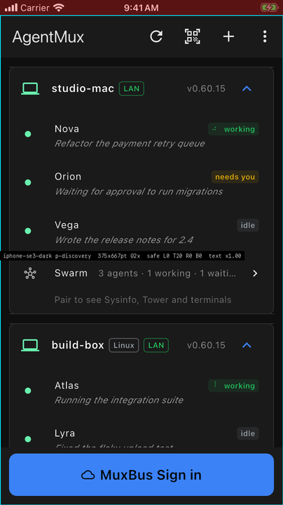

- **What people see**: a 20 pt status bar, then the app; **no bottom inset at all**: the "MuxBus Sign in" bar ends 12 pt above the screen's square bottom edge. Nothing is clipped: square corners, no island.
- **Edge defects**: none specific to the edges in portrait. In landscape there is no status bar and no inset; the "Connect manually" sheet overflows with the keyboard up (I4). At large text the bottom button takes a third of the screen (I7).
- **The status band** (section 6) has no band to live in here: design A shows nothing on the SE, so the status must go in the bar (design B).

### 4.2 iPhone with a notch: XS, XR, 11, 12, 13, 14, 14 Plus, 16e, 17e

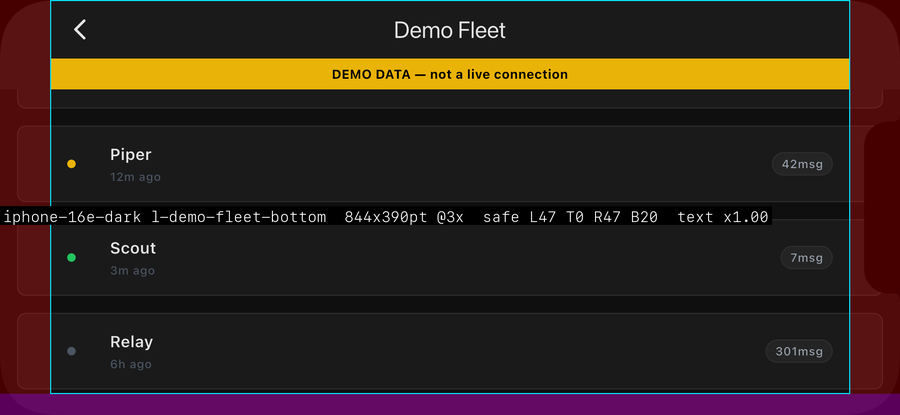

- **Portrait**: the notch sits inside the 44–50 pt top inset; the AppBar's colour fills up to the notch and corners. Bottom: the 34 pt band (I1).
- **Landscape**: the notch is on one side, and iOS reports a 44–50 pt inset on *both* sides. The AppBar and the bottom bar inset their content correctly, but **lists don't** (I2): message cards and host cards run edge to edge, under the notch.

### 4.3 iPhone with the Dynamic Island: 14 Pro and later, 15, 16, 17, Air

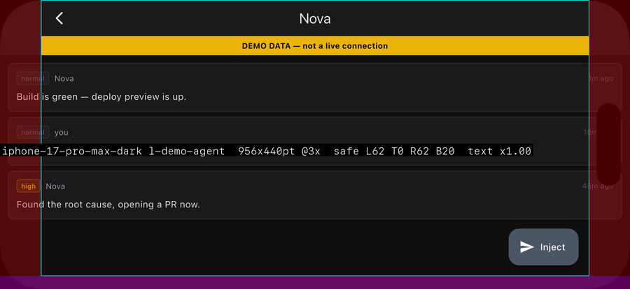
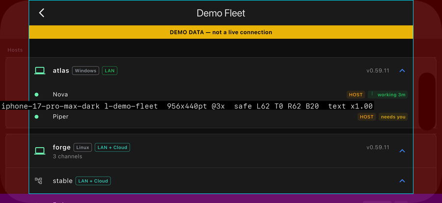

- **Portrait**: the top inset (59–68 pt) contains the island; the AppBar fills behind it. Nothing of ours is under the island in portrait.
- **Landscape**: the island is on the side. **The demo agent's message cards run under it and the "18m ago" timestamp is cut off** (I2); host cards in the demo fleet and discovery run under it too; the DEMO banner is inset on both sides, leaving dark gaps beside the yellow (I5). The feed's transcript list has the same padding pattern in its code (`agent_feed_screen.dart:470`), so real feed text runs under the island the same way.
- **The bottom band** (I1), portrait: under "MuxBus Sign in" the bar's surface colour (#1A1A1A) runs to the curved corners: correct colour, but 34 pt of nothing, the band the status ask is about.

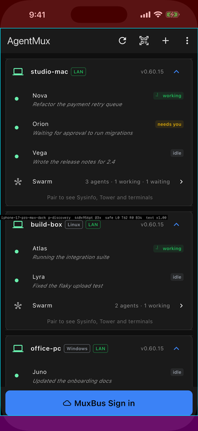

### 4.4 iPad: mini (A17 Pro), Pro 11" (M5), Pro 13" (M5)

iPadOS 26 runs an app either **full screen** or **as a window** (Settings › Multitasking & Gestures: Full Screen Apps, Windowed Apps or Stage Manager). The simulators showed both: the first boot of each iPad ran AgentMux full screen, later boots opened it as a window (iPadOS 26 records a multitasking-mode switch; the setting isn't scriptable here). Both are what real people see, so both are below.

**Full screen** (portrait):

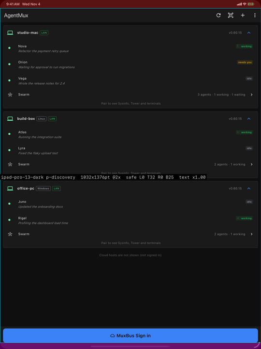
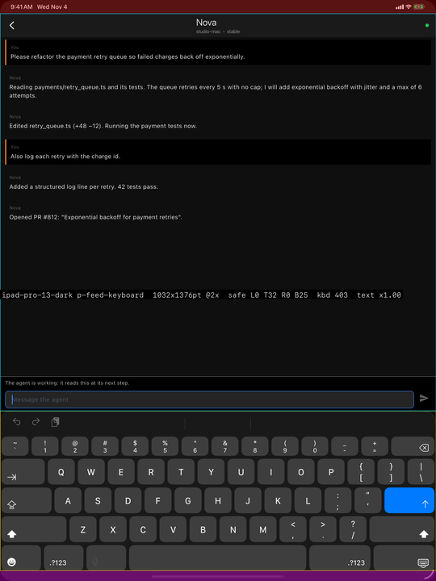

- **What people see**: the phone layout stretched to 744 (mini), 834 (Pro 11) or 1032 pt (Pro 13) wide: host rows with the name at the far left and the status pill ~900 pt away at the far right, the "MuxBus Sign in" button 1000 pt wide, the feed's lines running the full width. Insets: top 32 pt, bottom 25 pt, no sides. The bottom bar's colour reaches the rounded corners; the 25 pt band under it is empty (I1). The white snackbar runs 1032 pt wide (I3).
- **Keyboard**: the full iPad keyboard (with its shortcut row) sits directly under the composer, no gap.

**As a window** (landscape and some portrait runs):

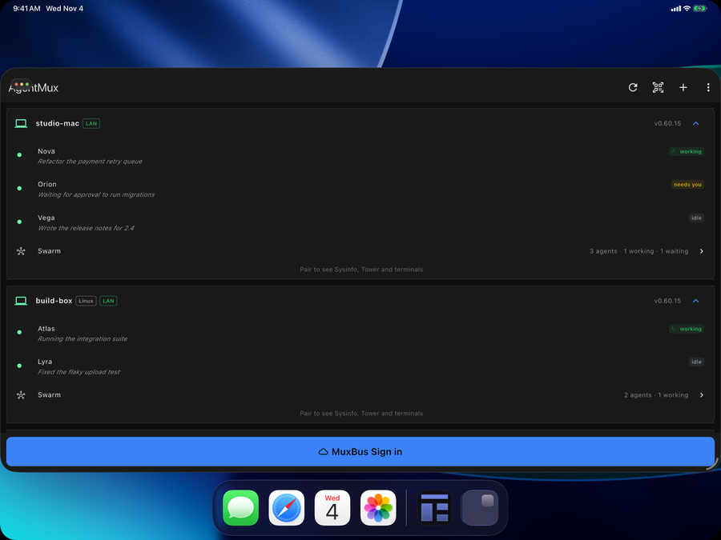
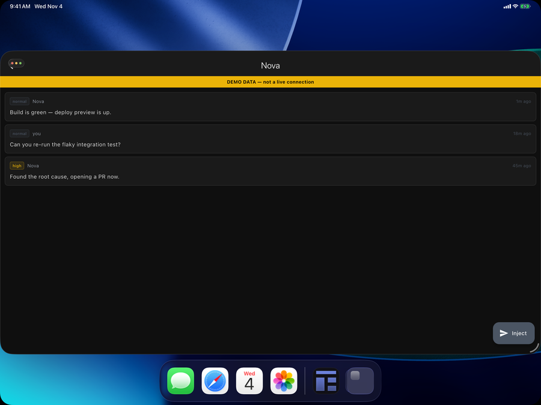
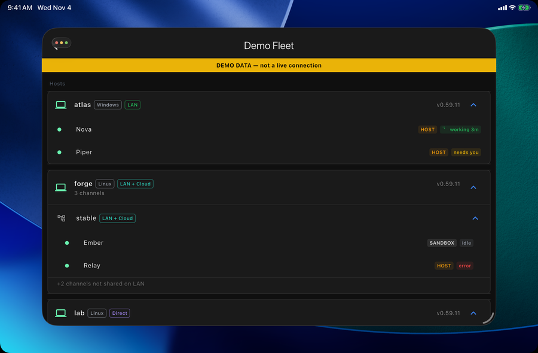

- **What people see**: a window (1376 × 774 pt on the Pro 13 in landscape, 957 × 629 on the mini) below the status bar with the Dock under it. Flutter reports only 10 pt top and bottom insets.
- **I9, new: the window controls cover our top-leading corner.** iPadOS draws the window's close/minimise/arrange controls (the three dots) over the app's top-leading corner, and Flutter's `MediaQuery.padding` doesn't include them. They cover the start of the "AgentMux" title on the discovery screen and **hide the back arrow entirely** on the demo fleet, demo agent, feed and Settings screens: the button is still there, under the dots, but nobody can see where to tap. The HIG (Windows): window controls sit at the leading edge of the toolbar, so leading toolbar items must move inward. **Fix**: when running windowed, pad the AppBar's leading edge by the control area: read UIKit's corner-adapted layout margins (iOS 26 `UIView.layoutMargins` with corner adaptation, exposed by the `ios_window_control_layout` package) or, failing that, add a fixed ~70 pt leading inset on iPad when the window isn't full screen (`MediaQuery.sizeOf(context)` smaller than the screen); test in Windowed Apps mode.
- **Light mode**: identical to dark (I6), full screen or windowed.

**Recommended iPad layout** (I8): list-detail from 840 pt: computers and agents in a ~360 pt leading column, the selected agent's feed with its composer filling the rest; a navigation rail from 600 pt. A full-screen Pro 13 in landscape (1376 pt) and a half-screen tile (~680 pt) then each get a sensible layout, and so do the Duo's inner display and Android tablets (one implementation). Under 600 pt (Slide Over, a third tile, a narrow window) the phone layout stays.

### 4.5 iPad tiles, Slide Over and Stage Manager

**Split View tiles, Slide Over and Stage Manager windows weren't captured as such.** Arranging windows on iPadOS 26 takes gestures in Simulator.app (drag to tile, the window controls' menu), and this Mac has no Accessibility permission for an agent to drive them. I tried emulating the tile sizes inside Flutter instead (giving the app a 368, 454, 684 or 914 pt wide view), but the simulator was already showing the app as a real window, so those captures showed the window chrome and the wallpaper, not our layout: I dropped them rather than ship misleading pictures.

What the real windowed captures above already show, and what follows for tiles and Slide Over:
- In any window, the **window controls cover the top-leading corner** (I9): in a narrow tile they sit on the title or the back button just the same.
- The app gets the window's size (Flutter's `MediaQuery.sizeOf`), and the layout is the phone column at any width: a third tile (~450 pt) or Slide Over (~320–375 pt) looks like an iPhone; a half tile (~680 pt) or a Stage Manager window looks like a stretched phone (I8).
- Insets in a window are small (10 pt top and bottom as reported) and change as the window touches the screen's edges; read them on every build, as the code does with `MediaQuery`, never from the device model.

**To capture the tiles for real**: a person drags the app into tiles in Simulator.app (or on an iPad) while the harness runs, or a short XCUITest drives the window controls' "Arrange" menu; I can add that if wanted.

## 5. Light and Dark, launch, Dynamic Type

**Light mode shows exactly what dark mode shows** (I6). A pixel diff of all 153 dark/light capture pairs finds the iPhone captures identical (one snackbar caught at a different moment), and the iPad pairs differing only in the system around the app (full screen vs window, the wallpaper's light variant), never in the app itself: the app has only `AppTheme.dark` and no `themeMode`, its AppBars ask for light status-bar icons (correct on its dark bars), and the keyboard follows the app's dark theme (`keyboardAppearance` defaults to the theme's brightness), not the OS. So a light-mode user gets a consistent dark app: **no white flashes**, no unreadable status bar, but not their chosen appearance either. Apple's HIG allows dark-only only in "rare cases" (immersive media); a status app is expected to follow the system.

**Launch**: the launch storyboard is a fixed dark colour (#111016) and the first frame is #0F0F0F/#1A1A1A: no flash, a barely visible shift, in either appearance. To support Light: give the storyboard a named colour with Any and Dark values matching each theme's first screen.

**Fix**: a light `ThemeData` built from the same `ColorScheme` roles, `MaterialApp.router(theme: light, darkTheme: dark, themeMode: ThemeMode.system)`; replace the fixed `AppColors.*` in widgets with `Theme.of(context).colorScheme` roles; AppBar sets the status-bar style automatically (on iOS only `statusBarBrightness` counts).

**Dynamic Type** (iPhone SE 3 and 17 Pro Max, XXXL ×1.35 and AX5 ×3.12):

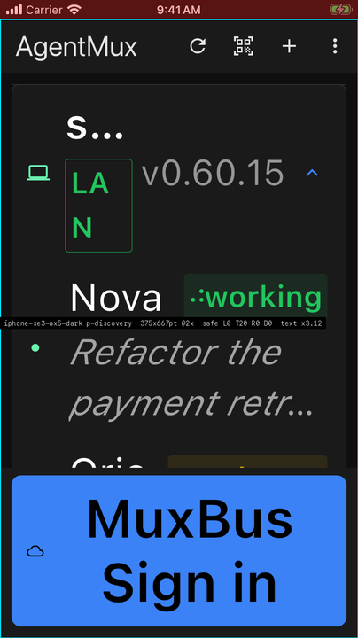
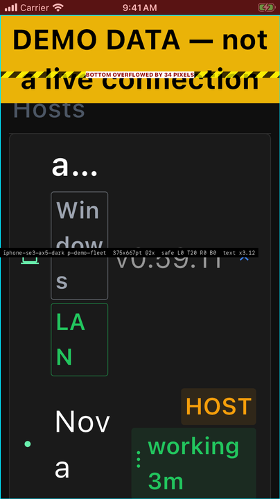

- AX5: host names truncate to "s…"; the LAN badge wraps to "LA / N"; version labels push names out; the DEMO banner overflows its fixed 28 pt (`DemoBanner.preferredSize`, "BOTTOM OVERFLOWED BY 34 PIXELS"); "MuxBus" breaks across lines on the sign-in screen; the "MuxBus Sign in" button grows to a third of the SE's screen; the landscape feed overflows.
- XXXL: everything fits; nothing breaks.
- **Fix**: let content rows wrap (no `maxLines: 1` on names; badges below the name when they don't fit); clamp only fixed-height chrome (badges, the banner, the bottom button) with `MediaQuery.withClampedTextScaling(maxScaleFactor: 2.0)`; size `DemoBanner` from `MediaQuery.textScalerOf(context)`; `FittedBox` for the sign-in title.

## 6. Filling the curved bottom with status: three designs

The data each design shows: connection (LAN / cloud / offline), how many computers, how many agents are working and waiting, and the demo state. All three are non-interactive (Apple's bottom edge is the system's swipe-home zone; HIG "Going full screen") and low-contrast.

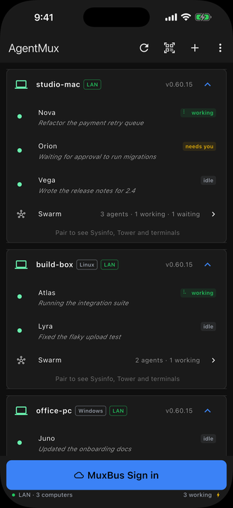
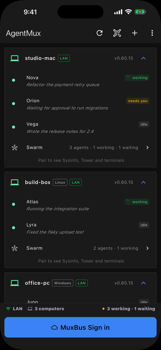
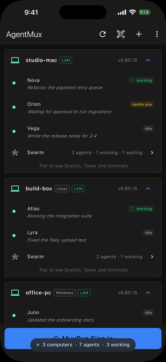

- **A, the band itself carries status.** One line of 11 pt muted text in the 34 pt home-indicator band, on either side of the indicator: "● LAN · 3 computers" at the leading edge and "3 working ⚡" at the trailing edge. The band is painted in the bar's surface colour to the corners, the text sits inset from the curve (22 pt + side inset), and the centre stays clear for the indicator. Uses space that is empty today; changes no layout above it. Collapses where there is no band (SE) and shrinks to 20 pt in landscape.
- **B, a status row on top of the bottom bar.** A 30 pt row of 12 pt text (Wi-Fi/LAN, computers, working and waiting) above "MuxBus Sign in", in the bar's colour; the home-indicator band below stays clear. Works on every device including the SE and the Duo's outer display, but takes 30 pt from the list.
- **C, a floating glass capsule.** A centred, blurred capsule just above the indicator, in the iOS 26 Liquid Glass style; content runs under it to the edge. It covers the "MuxBus Sign in" button on the discovery screen and the text behind it shows through on the demo fleet (Flutter's `BackdropFilter` isn't Apple's glass); it also floats over content, which Apple reserves for controls.

**Pick: A, falling back to B.** A answers the ask literally (the curved bottom becomes status), costs no content space, and keeps everything interactive above the inset. Where `MediaQuery.viewPaddingOf(context).bottom` is under ~20 pt (iPhone SE, home-button iPads, the Duo's outer display, landscape on small phones), show the same line as B's row inside the bar. Implement it as part of the bottom bar: a `Material(color: surface)` wrapping a `Column(button, SizedBox(height: viewPadding.bottom, child: statusLine))`, the `NavigationBar` pattern (paint the full width, inset the content); keep it out of `SafeArea` so it reaches the curve, use `viewPadding` (not `padding`) so it doesn't jump when the keyboard opens, and hide it while the keyboard is up. Clamp its text scale (it can't grow past the band) and give it a `Semantics` label, since it holds information people rely on.

On screens without a bottom bar (demo fleet, agent, feed), the band belongs to the scrolling content: give lists the bottom inset (I1/I2) so the last item ends above the indicator, and let the background run under it.

**The same designs elsewhere:**

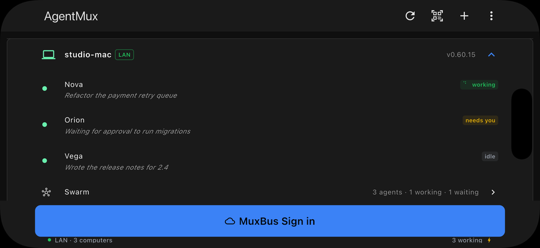
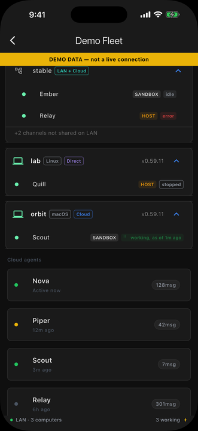
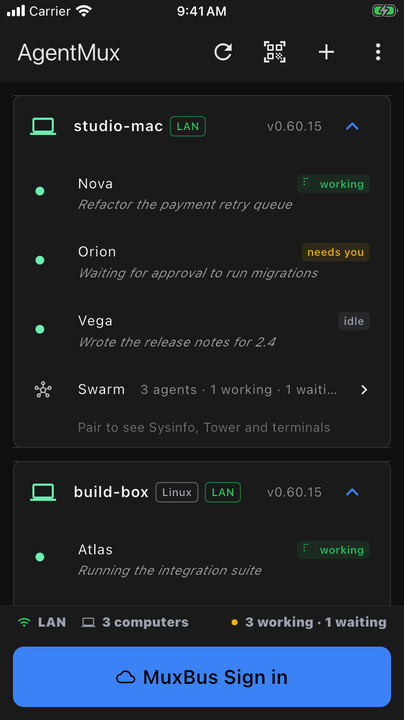

- **Landscape** (20 pt band): A's line still fits, sitting close to the curve; B's row is unchanged; C's capsule covers the button.
- **iPhone SE**: A has no band and shows nothing (by design); B is the one that works, which is why A falls back to B.
- **Demo fleet** (no bottom bar): A turns the band into an opaque status strip over the list's end; this is where the list's bottom inset (I1) matters, so the last card ends above the strip.
- **iPad** (25 pt band, wide): the A line works, with a lot of empty width between its two halves; on iPad, B's row (or a status area in a sidebar, once the list-detail layout exists) uses the width better. Captures in `mockups/ipad-pro-11-*`.

These mockups are overlays drawn on the running app (a Flutter `OverlayEntry`), not a build of the feature: the list doesn't make room for B's row, and C's blur is Flutter's `BackdropFilter`, not Apple's Liquid Glass.

## 7. Edge defects in detail

### I1. The home-indicator band is empty, and lists scroll into it

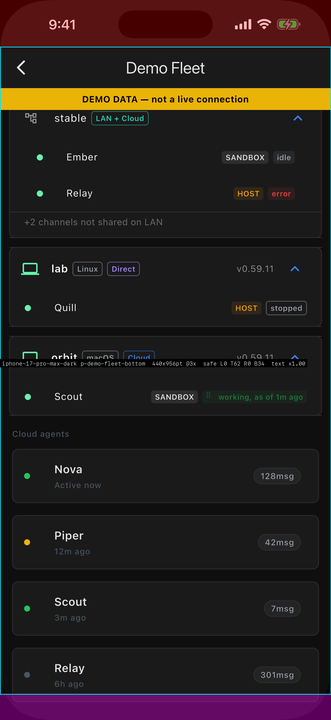

- **Devices**: every Face ID iPhone (34 pt portrait, 20 pt landscape), every iPad (25 pt).
- **What's wrong**: on the discovery screen, `MuxbusAccountBar` paints its surface through the band correctly (`Material` outside its `SafeArea`), but the band holds nothing: 34 pt of flat grey under a 56 pt button. On the demo fleet and agent screens (no bottom bar) the band shows the list background, and **the last card reaches into the band, under the home indicator** (by a few points on the 17 Pro Max), because the list's padding is a fixed 12 pt (`demo_fleet_screen.dart:28`, `demo_agent_detail_screen.dart:37`).
- **Fix**: the status band (section 6) on screens with a bottom bar. Lists: `padding: const EdgeInsets.all(12) + EdgeInsets.only(bottom: MediaQuery.paddingOf(context).bottom)` (or `SliverSafeArea(top: false)` around the sliver), so the last item clears the indicator while the background still runs under it.

### I2. Lists ignore the side insets in landscape (content under the notch or Dynamic Island)

- **Devices**: every Face ID iPhone in landscape (side insets 44–68 pt; the Air's 68 pt is the widest).
- **What's wrong**: Flutter's `ListView` adds the safe area as padding only when `padding` is null. These lists pass their own, so the insets are dropped: `discovery_screen.dart:231` (host list), `demo_fleet_screen.dart:28`, `demo_agent_detail_screen.dart:37`, `agent_feed_screen.dart:470` (the feed transcript: only top and bottom padding). Cards and text start 12 pt from the physical edge; on the island side they run under it and the demo agent's "18m ago" is cut off; on the other side they come within 12 pt of the curved corner.
- **Fix**: `padding: const EdgeInsets.all(12) + MediaQuery.paddingOf(context)` with the top removed where an AppBar already consumed it (`MediaQuery.removePadding` does that inside a Scaffold body). Card backgrounds and dividers may run to the edge (wrap only the content in `SafeArea(top: false, bottom: false)`), but text and controls must not.

### I3. The snackbar is a white slab across the curved bottom

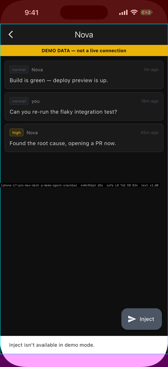
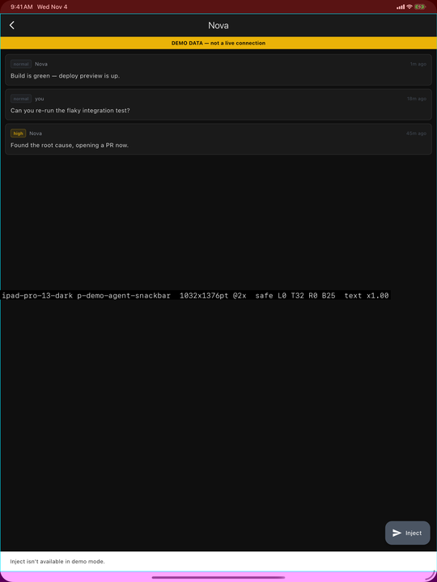

- **Devices**: all, both appearances.
- **What's wrong**: `AppTheme.dark` sets no `snackBarTheme`, so Material 3's default is used: `inverseSurface` (near white) and `SnackBarBehavior.fixed`, full width. In a dark app that is the brightest thing on screen, and it fills the home-indicator band and both curved corners; on iPad it runs 1032 pt wide.
- **Fix**: `snackBarTheme: SnackBarThemeData(behavior: SnackBarBehavior.floating, backgroundColor: AppColors.surfaceVariant, contentTextStyle: TextStyle(color: AppColors.textPrimary), shape: RoundedRectangleBorder(borderRadius: BorderRadius.circular(12)), width: 560 /* on wide windows */)`. A floating snackbar sits above the home indicator (Flutter adds `viewPadding.bottom`) with rounded corners, which reads as concentric with the display.

### I4. "Connect manually" overflows in landscape with the keyboard up

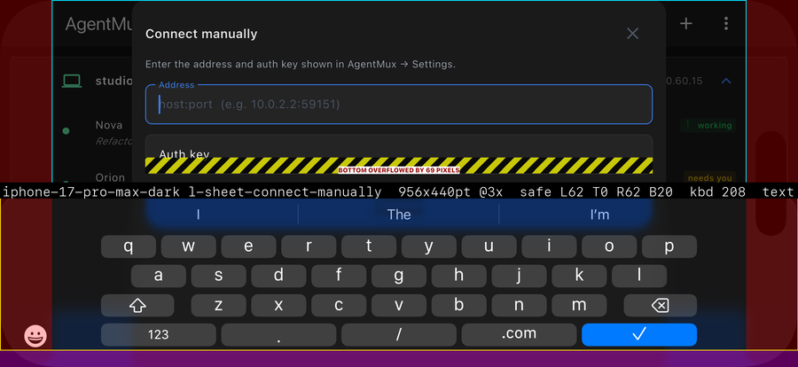
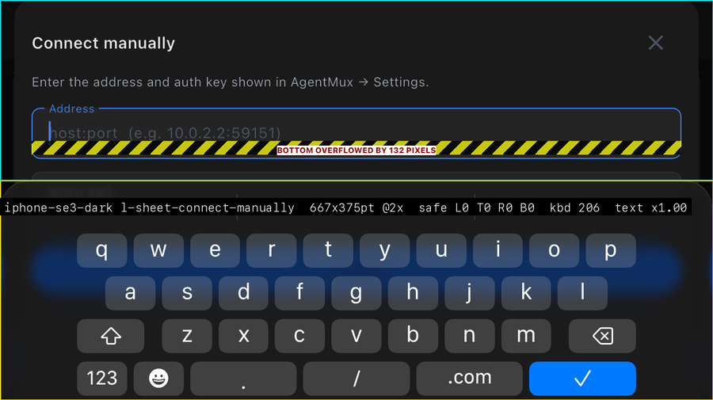

- **Devices**: every iPhone in landscape (found by the overflow scan on all 5 matrix iPhones, dark and light).
- **What's wrong**: the sheet's `Column` is taller than the space left above a landscape keyboard (208 pt of keyboard on a 440 pt-high screen), so Flutter draws its overflow stripes ("BOTTOM OVERFLOWED BY 69 PIXELS" on the 17 Pro Max) and the Connect button is unreachable.
- **Fix**: in `showManualAddSheet`, `useSafeArea: true`; in `ManualAddSheet`, wrap the body in `SingleChildScrollView(padding: EdgeInsets.only(bottom: MediaQuery.viewInsetsOf(context).bottom))`.

### I5. The DEMO banner doesn't reach the edges, and can't grow

- **What's wrong**: in landscape the AppBar insets its `bottom` widget, so the yellow strip stops at the safe area and leaves dark gaps beside it up to the curved edges. At accessibility text sizes it overflows its fixed `preferredSize` of 28 pt (`demo_banner.dart`).
- **Fix**: paint the yellow full width and inset only the text: `Container(color: warning, child: SafeArea(top: false, bottom: false, child: Text(...)))`, placed so it spans the whole width (a body header instead of `AppBar.bottom`, or `AppBar.flexibleSpace`). Compute `preferredSize` from the text scaler, or clamp its text to ×2.

### I6. Light mode looks exactly like dark mode

- See section 5. **Fix**: a light theme, `themeMode: ThemeMode.system`, colour roles instead of fixed `AppColors`, and an adaptive launch-screen colour.

### I7. Dynamic Type breaks the chrome at accessibility sizes

- See section 5 for the list and fixes.

### I8. No layout for wide windows (iPad, Duo inner display)

- See sections 4.4, 4.5 and 9. **Fix**: one adaptive scaffold keyed on window width (`MediaQuery.sizeOf(context).width`, `LayoutBuilder`): < 600 pt one column as today; 600–840 a navigation rail and a wider single column with a max content width (~640 pt); ≥ 840 list-detail (computers and agents on the left, the selected agent's feed and composer on the right). Base it on the window size, never on the device type, because a third-width iPad tile is narrower than a Pro Max.

### What is already right

- The AppBar's colour fills behind the status bar, notch and island to the corners, on every device and orientation; the status-bar icons are light on it in both appearances.
- The "MuxBus Sign in" bar paints its colour to the bottom edge and corners (`Material` outside `SafeArea`), on iPhone and iPad.
- The feed's composer (`SendPanel`) keeps above the keyboard and the home indicator (`SafeArea(top: false)`), with no gap to the keyboard in portrait or landscape.
- Bottom sheets clear the keyboard in portrait; the ⋮ menu stays inside the safe area in landscape.

## 8. Best practices (sources)

The full notes, with every link, are in [research.md](form-factors/apple/research.md). Key points:

- **Backgrounds and bar colours go edge to edge; controls and text stay inside the safe area** (HIG Layout). Paint a bar outside its `SafeArea`, put its content inside: that is how Flutter's `NavigationBar` does it.
- **The home-indicator area is a system-gesture zone**: no interactive controls there; passive status is not prohibited anywhere in the HIG. Don't hide the indicator or defer the gesture (`prefersHomeIndicatorAutoHidden`, `preferredScreenEdgesDeferringSystemGestures`) for a status app.
- **The Dynamic Island**: don't draw attention to it; status *in* the island is a Live Activity (a native SwiftUI widget extension with ActivityKit), a separate feature from the in-app band.
- **iPadOS 26 windowing**: Split View and Slide Over became resizable windows (26.0; Slide Over returned in 26.1, tiling gestures in 26.2); `UIRequiresFullScreen` is deprecated and stops opting out of resizing with the iOS 27 SDK (TN3192). Apps must lay out for any width. Window controls overlap the top-leading corner, which Flutter's `MediaQuery.padding` doesn't report.
- **Dark Mode**: support both; follow the system; adaptive launch screen; no app-only appearance switch unless there is a reason.
- **Liquid Glass (iOS 26)**: scroll-edge effects instead of solid strips under floating controls; concentric corners (Flutter has no API for the display radius; Apple publishes none; full-bleed colour needs none because the display clips it).
- **Flutter**: `MediaQuery.paddingOf` vs `viewPaddingOf` vs `viewInsetsOf`; `SafeArea(maintainBottomViewPadding: true)`; an explicit `ListView(padding:)` disables the automatic safe-area padding; `Scaffold.extendBody`; `AnnotatedRegion<SystemUiOverlayStyle>`; `ThemeMode.system`. Material 3 window size classes: compact < 600, medium < 840, expanded < 1200 (dp/pt): rail at 600, list-detail at 840 (`flutter_adaptive_scaffold` is discontinued; use `LayoutBuilder`).

Links: Apple HIG [Layout](https://developer.apple.com/design/human-interface-guidelines/layout), [Going full screen](https://developer.apple.com/design/human-interface-guidelines/going-full-screen), [Live Activities](https://developer.apple.com/design/human-interface-guidelines/live-activities), [Windows](https://developer.apple.com/design/human-interface-guidelines/windows), [Multitasking](https://developer.apple.com/design/human-interface-guidelines/multitasking), [Dark Mode](https://developer.apple.com/design/human-interface-guidelines/dark-mode), [Designing for iPhone Duo](https://developer.apple.com/design/human-interface-guidelines/designing-for-iphone-duo); [Adopting Liquid Glass](https://developer.apple.com/documentation/technologyoverviews/adopting-liquid-glass); [TN3192 UIRequiresFullScreen](https://developer.apple.com/documentation/technotes/tn3192-migrating-your-app-from-the-deprecated-uirequiresfullscreen-key); [TN3187 UIScene](https://developer.apple.com/documentation/technotes/tn3187-migrating-to-the-uikit-scene-based-life-cycle); WWDC25 [219](https://developer.apple.com/videos/play/wwdc2025/219/), [356](https://developer.apple.com/videos/play/wwdc2025/356/), [282](https://developer.apple.com/videos/play/wwdc2025/282/); Flutter [SafeArea](https://api.flutter.dev/flutter/widgets/SafeArea-class.html), [MediaQueryData.viewPadding](https://api.flutter.dev/flutter/widgets/MediaQueryData/viewPadding.html), [ThemeMode](https://api.flutter.dev/flutter/material/ThemeMode.html), [adaptive design](https://docs.flutter.dev/ui/adaptive-responsive/general), [UIScene adoption](https://docs.flutter.dev/release/breaking-changes/uiscenedelegate); Android [window size classes](https://developer.android.com/develop/ui/compose/layouts/adaptive/use-window-size-classes).

## iPhone Duo (Apple's foldable): not captured yet

**Status.** The build Mac has only Xcode 26.6 (17F113), with the iOS 18.2 and 26.5 simulator runtimes. `xcrun simctl list devicetypes` has no foldable or two-screen iPhone type (the full list is in the appendix), so the captures and numbers below come from Apple's published documentation, not from a simulator. None of these numbers come from the third-party articles.

**What it takes to capture it:**
1. macOS 26.6 or later. Xcode 27.x requires macOS Tahoe 26.6 or later; the build Mac runs 26.5.2, so it needs a system update and a restart.
2. Xcode 27.1 (27A9275, final, 2026-10-15) or 27.2 (27B52, 2026-10-29), from the Mac App Store, developer.apple.com/download/applications or `xcodes`. Each needs an Apple ID sign-in. Then the iOS 27.x simulator runtime (`xcodebuild -downloadPlatform iOS`) and Device Hub, which opens, closes, folds and rotates the simulated device.
3. Before the Duo build: the app must adopt the UIScene life cycle. Apple's TN3187: apps built with the iOS 27 SDK that haven't migrated "fail to launch with a runtime assertion". `ios/Runner/Info.plist` has no `UIApplicationSceneManifest` today. Flutter migrates eligible apps automatically from 3.41 (`docs.flutter.dev/release/breaking-changes/uiscenedelegate`); the app pins 3.38.9.

**What Apple documents** (HIG "Designing for iPhone Duo", 2026-09-09; "Preparing your app for iPhone Duo"; App Store Connect screenshot specifications):

| | Outer display (closed) | Inner display (open) |
|---|---|---|
| Screenshot size (px) | 1398 × 2034 portrait, 2034 × 1398 landscape | 2007 × 2853 portrait, 2853 × 2007 landscape |
| Size class (HIG) | compact width | regular width |
| Bars | the system puts toolbars, tab bars and navigation controls **vertically on the side** ("wider and shorter than the display on other iPhone devices") | horizontal in portrait; on the side in landscape |
| Camera | front camera in a corner, "always visible", a permanent reserved region that grows into the Dynamic Island for Live Activities | under the display, a reserved region only while the camera is active |
| Fold | none | when partly folded, a **folding region** splits the display into usable regions ("excluding the region at the center as the display folds") |

Point sizes and safe-area values aren't published; they come from the simulator, and the screenshot pixel sizes alone don't give the scale factor. Poses: closed, open (flat), partly folded like a book, on a table, standing on an edge; each one can be rotated. Split View multitasking runs on the inner display, with each app's bars on its outer edge.

**What our current build (Xcode 26.6, iOS 26 SDK) would show on a Duo.** Apple: "When you build with Xcode 26 and earlier, your app doesn't extend under the status bar and camera." So today's app runs **inset**: the system keeps it out of the status bar and camera areas instead of running it edge to edge. Our AppBar and bottom-bar colours would then stop short of the display edges and corners, which is the "unfilled band" effect this report is about. How the system fills those areas can only be seen in the simulator. Nothing in the docs mentions letterboxing or stretching the rest of the app; it resizes the app's window, so our layout gets the window size and has to adapt. On the inner display that is a large regular-width window (the app shows one stretched phone column today, as on iPad; see the iPad section). When partly folded, our full-width list rows and the composer would cross the fold, because Flutter has no `ReservedRegion` API yet.

**Recommended layout for the Duo** (with the iPad and Android foldable layouts):
- **Closed (outer, compact width):** today's single column, with the bottom bar's controls as they are. Apple moves *system* bars to the side; our bars are Flutter widgets, so they stay where we draw them unless we follow the side placement. Keep interactive controls clear of the corner camera (it is a reserved region; check with the simulator).
- **Open (inner, regular width): list-detail.** Computers and agents in the leading pane, the selected agent's feed with the composer in the trailing pane. That is Apple's own example: Mail shows a list *or* a message when closed, both side by side when open. It is also Material's list-detail canonical layout at expanded width (≥ 840 dp), so one implementation serves the Duo, iPad and Android foldables.
- **Partly folded (book or tabletop):** split the two panes **at the fold**: list on one side, feed on the other; tabletop: feed above the fold, composer and keyboard below. In Flutter the fold's position needs a small platform channel to UIKit's `reservedRegions(kind:options:)` (iOS 27.1 SDK) until Flutter exposes it; on Android, `DisplayFeature` from `MediaQuery.displayFeatures` already gives the hinge.
- **Status band:** on the outer display the system's side bar holds the status bar and Dynamic Island, so the bottom-band status (design A) has no home-indicator band to sit in there. Use the in-bar status row (design B), which works in every pose.

Sources: https://developer.apple.com/design/human-interface-guidelines/designing-for-iphone-duo ; https://developer.apple.com/documentation/technologyoverviews/preparing-your-app-for-iphone-duo ; https://developer.apple.com/help/app-store-connect/reference/screenshot-specifications ; https://developer.apple.com/iphone-duo/ ; https://developer.apple.com/documentation/technotes/tn3187-migrating-to-the-uikit-scene-based-life-cycle ; https://docs.flutter.dev/release/breaking-changes/uiscenedelegate ; Xcode releases: https://developer.apple.com/news/releases/

## Appendix A: simulator device types on the build Mac (Xcode 26.6)

**iPhone (43)**: iPhone 17 Pro, iPhone 17 Pro Max, iPhone 17e, iPhone Air, iPhone 17, iPhone 16 Pro, iPhone 16 Pro Max, iPhone 16e, iPhone 16, iPhone 16 Plus, iPhone 15 Pro, iPhone 15 Pro Max, iPhone 15, iPhone 15 Plus, iPhone 14 Pro, iPhone 14 Pro Max, iPhone 14, iPhone 14 Plus, iPhone SE (3rd generation), iPhone 13 Pro, iPhone 13 Pro Max, iPhone 13, iPhone 13 mini, iPhone 12 Pro, iPhone 12 Pro Max, iPhone 12, iPhone 12 mini, iPhone SE (2nd generation), iPhone 11 Pro, iPhone 11 Pro Max, iPhone 11, iPhone Xʀ, iPhone Xs, iPhone Xs Max, iPhone X, iPhone 8, iPhone 8 Plus, iPhone 7, iPhone 7 Plus, iPhone SE (1st generation), iPhone 6s, iPhone 6s Plus, iPod touch (7th generation).

**iPad (43)**: iPad Pro 13-inch (M5) (16GB), iPad Pro 13-inch (M5), iPad Pro 11-inch (M5) (16GB), iPad Pro 11-inch (M5), iPad Pro 11-inch (M4) (16GB), iPad Pro 11-inch (M4), iPad Pro 13-inch (M4) (16GB), iPad Pro 13-inch (M4), iPad Air 13-inch (M4), iPad Air 11-inch (M4), iPad (A16), iPad Air 13-inch (M3), iPad Air 11-inch (M3), iPad Air 11-inch (M2), iPad Air 13-inch (M2), iPad mini (A17 Pro), iPad Pro (11-inch) (4th generation) (16GB), iPad Pro (11-inch) (4th generation), iPad Pro (12.9-inch) (6th generation) (16GB), iPad Pro (12.9-inch) (6th generation), iPad (10th generation), iPad Air (5th generation), iPad mini (6th generation), iPad Pro (11-inch) (3rd generation), iPad Pro (12.9-inch) (5th generation), iPad (9th generation), iPad Air (4th generation), iPad (8th generation), iPad Air (3rd generation), iPad mini (5th generation), iPad Pro (11-inch) (2nd generation), iPad Pro (12.9-inch) (4th generation), iPad Pro (11-inch) (1st generation), iPad Pro (12.9-inch) (3rd generation), iPad (7th generation), iPad Pro (10.5-inch), iPad Pro (12.9-inch) (2nd generation), iPad (6th generation), iPad Pro (9.7-inch), iPad Pro (12.9-inch) (1st generation), iPad (5th generation), iPad Air 2, iPad mini 4.

No foldable, flip or two-screen type. Runtimes installed: iOS 18.2 and iOS 26.5.

## Appendix B: files

`form-factors/apple/deliver/originals/<set>/` and `form-factors/apple/deliver/insets/<set>/`, named `<device>-<orientation>-<appearance>[-<text size>]-<screen>.png`; sets: `main`, `all-iphones`, `dynamic-type`, `mockups`, plus `originals/launch` (the first frames after launch). Screens: `discovery`, `discovery-menu`, `sheet-connect-manually`, `demo-fleet`, `demo-fleet-bottom`, `demo-agent`, `demo-agent-snackbar`, `feed`, `feed-keyboard`, `settings`, `signin`, `qr-scan`; mockups `mockA/B/C-discovery`, `-demo-fleet`.

Notes on the captures: on the iPhone 16e, 17 and SE in landscape the harness's tap on an agent missed, so those runs have no `demo-agent` and `demo-agent-snackbar` captures (removed rather than mislabelled); the first boot of a fresh simulator shows some system UI of its own (an "Apple Intelligence" notification, the swipe-typing tip) in a few frames; Settings shows "Version 0.1.0+dev" because this is a local build; the demo fleet's version labels (v0.59.11) are its demo data.

---

# Part B: Android

*By QTest. Emulators on Android 15 (API 35, where edge-to-edge is enforced for apps targeting 35): Pixel 9 (1080x2424), Pixel Fold (inner 2208x1840, outer 1080x2092), and a Pixel 3a resized to a 320 dp width. Captured with `adb screencap` (the Fold per display). Images in `form-factors/android/`.*

## B.1 Where the app stands today (code)

| Area | Today |
|---|---|
| Color mode | **Dark only.** `AppTheme.dark`, no `ThemeMode`, no light palette. The OS light setting changes nothing in the app. |
| Safe areas | `SafeArea` is used in 4 places (the host sheet, the MuxBus account bar, the send panel, the login screen). Everything else leans on `Scaffold`/`AppBar` for the top and bottom bars. |
| Large screens and foldables | No width classes, no `displayFeatures` (hinge) handling. One phone layout at every width. |
| Orientation | iOS: portrait and both landscapes (iPad all four). Android: rotation allowed; `configChanges` includes orientation, screenSize and uiMode. |

## B.2 Pixel 9, gesture navigation (the common case)

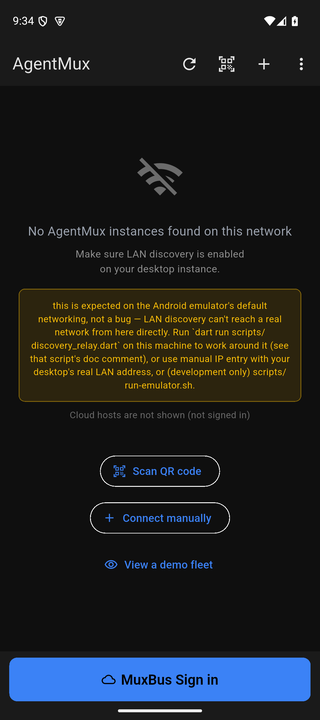

Works: the status bar and the gesture area are filled by the app's own dark background (edge-to-edge is on), the sign-in bar clears the gesture pill, nothing is cut.

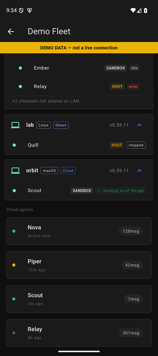

Works: at the end of the list the last card clears the gesture pill.

**A1 (minor):** mid-scroll, cards slide under the gesture pill with no scrim, so the pill is drawn over card content (`form-factors/android/p9_dark_gesture_demo_fleet.png`). Fix: keep the pill's background solid (a short gradient at the bottom edge) or inset the list's bottom padding by `MediaQuery.paddingOf(context).bottom`, as for iOS I1.

## B.3 Pixel 9, three-button navigation

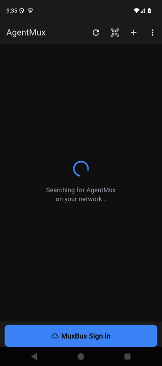

Works: the navigation bar's strip sits below the sign-in bar; nothing overlaps.

## B.4 Landscape

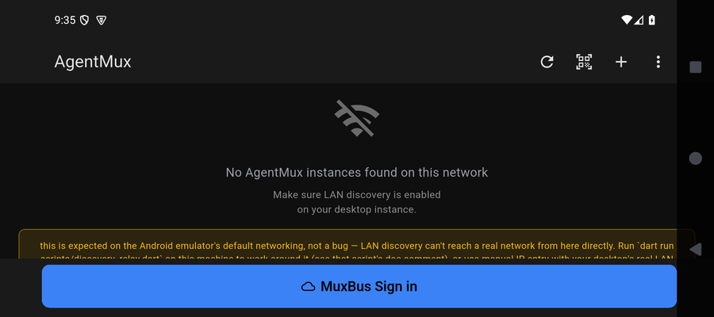

**A2 (major):** in landscape the top bar and the pinned "MuxBus Sign in" bar take about 40% of the height. The page's own content (the note and the three buttons) is left with a thin strip, and its last visible line is cut by the bar. The sign-in bar's left inset (about 115 px) is wider than the content's, and the three-button navigation sits on the right edge, so bar and content do not line up at either side. Fix: do not pin a full-width sign-in bar in landscape (put it in the app bar or in the scrolling content), and take the horizontal inset from one `SafeArea`.

## B.5 OS light mode

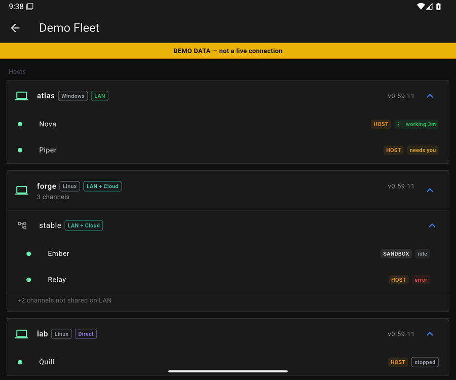

**A3 (major, the color-mode ask):** with the OS in light mode the app stays dark. The status-bar icons stay light-on-dark, which is correct for a dark app and would be wrong the moment a light theme exists unless `SystemUiOverlayStyle` is set from the theme. Fix: the same as iOS I6 (one light theme, `ThemeMode.system`); the manifest already declares `uiMode` in `configChanges`, so Flutter gets the change without restarting the activity.

## B.6 Pixel Fold

Closed (outer screen, 1080x2092): behaves like a phone, nothing cut.

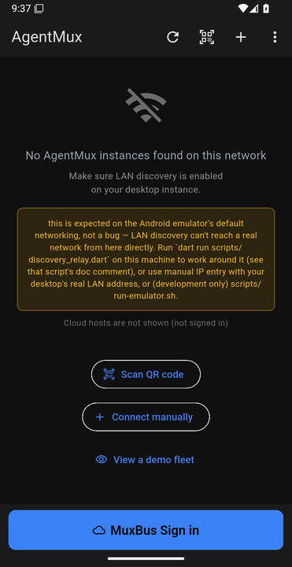

Unfolded (inner screen, 2208x1840):

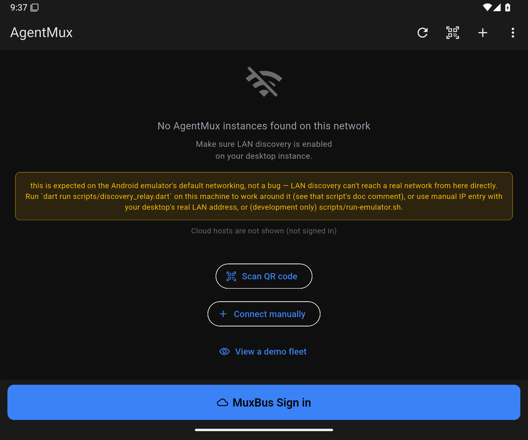

**A4 (major):** the phone layout is stretched across the 2208 px inner screen. The sign-in bar runs edge to edge, body text lines are far too long, and in the fleet list each agent's name is at the far left while its status badges are at the far right, about 1,400 px apart, so a row cannot be read across. Nothing is cut off, but it looks unfinished on every foldable and tablet. It is the same problem as iPad (I8) and the iPhone Duo inner display: one adaptive layout serves all of them.

**A5 (minor):** half-open gets no hinge handling: the same stretched page is drawn across the hinge (`form-factors/android/fold_half_d0.png`). Nothing important sits on the hinge today because the content is centred, but a list would run across it. Fix: read `MediaQuery.displayFeatures` and keep text and controls off a hinge or fold; in tabletop posture put the feed above the fold and the composer below it.

## B.7 Small screens and large text

Pixel 3a at a 320 dp width with the system font at its largest scale (2.0):

Works: text wraps, the page scrolls (`form-factors/android/small320_font2_launch_scrolled.png`), the sign-in bar stays reachable.

**A6 (minor):** the app-bar title truncates to "Agen..." because the three action icons take the width. Fix: move the refresh icon into the overflow menu below about 360 dp.

## B.8 What Android does not cover here

A 10-inch tablet (the unfolded Fold at 2208x1840 stands in for it: same width class), Android 16, the predictive-back gesture, and the Surface Duo.

## B.9 Best practice used (Android)

- Android 15: targeting SDK 35 enforces edge-to-edge; draw behind the system bars, then inset the content. Handle `systemBars`, `displayCutout`, gesture and `ime` (keyboard) insets. In Flutter, `Scaffold` and `SafeArea` handle the bars; `SystemUiOverlayStyle` sets icon contrast.
- Large screens: window size classes (compact under 600 dp, medium 600 to 840, expanded over 840), a maximum content width, list-detail on expanded, and `displayFeatures` for folds and hinges. Play grades large-screen quality.
- Color mode: follow the system by default (`ThemeMode.system`).

QTest (Part B and summary), Clare (Part A)

## Fix status

| Fix PR | Covers | State |
|---|---|---|
| 1. Safe areas and insets | I2 (lists keep clear of the notch and island), I1 (lists end above the home-indicator band), I4 (Connect manually scrolls above the keyboard), I5 (the DEMO banner reaches both edges and wraps at large text), A1 (bottom inset on lists), A2 (the sign-in bar is compact on short screens) | merged (#103) |
| 2. Bottom status band (design A, fallback B) | I1 (the empty band itself) | merged (#104) |
| 3. OS color mode and the snackbar | I6, A3, I3 | this change, for the app's own screens and the Android launch window; the feed (its own palette; it stays dark in either mode until it has a light set) and the iOS launch screen follow |
| 4a. Wide-screen basics | A4 and I8 (a centred 640 dp column on tablets and unfolded foldables), I9 (the iPadOS window controls), A5 (nothing across a hinge) | this change |
| 4b. List-detail and a rail | I8, the rest | open, waits for the operator's choice between list-detail and wider columns only |
| 5. Large text | I7, A6 | this change |
| 6. UIScene migration | P1 | open |

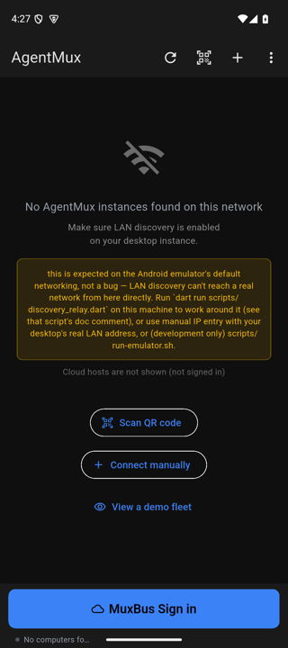

Design A as built: one muted line in the band under the sign-in button (here "No computers" because no computer is reachable from the emulator), the middle left clear for the gesture pill or home indicator. Where there is no band the same line is a row above the button (design B), and it is left out while the keyboard is up.

### Color mode as built

The app follows the OS setting (`ThemeMode.system`) with a light and a dark theme built from the same palette roles (`AppPalette`, read as `context.palette`). The dark set is unchanged. The light set's text and status colours reach 4.5:1 on the light backgrounds (a unit test checks it), and the tag and banner colours have darker shades on light. The status-bar and navigation-bar icons follow the theme, and a message is now a floating, rounded card in the surface colour, capped at 480 dp wide on a tablet or unfolded foldable. On Android the launch window takes the same background in each mode.

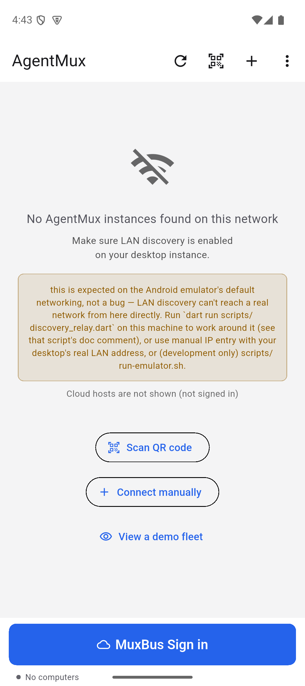

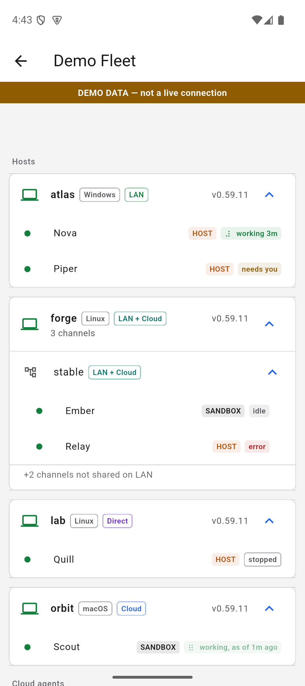

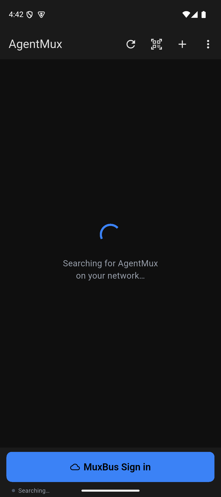

### Wide screens as built (4a)

On a window whose shortest side is 600 dp or more (a tablet, an iPad window, an unfolded foldable) every page's content is a centred column at most 640 dp wide (760 for the feed), so a row can be read across; the bars and banners keep their colour edge to edge. Phones, in either orientation, are unchanged. The sign-in bar's button and status line use the same column. On an iPad running as a window, the top bar's leading edge moves in by 70 pt so the window controls no longer cover the back arrow (the check is that the window is smaller than the display; it needs a look in Windowed Apps mode on a real iPad). In a half-open posture the app uses the sub-screen at the leading edge, so nothing is drawn across the hinge; a flat fold is one screen.

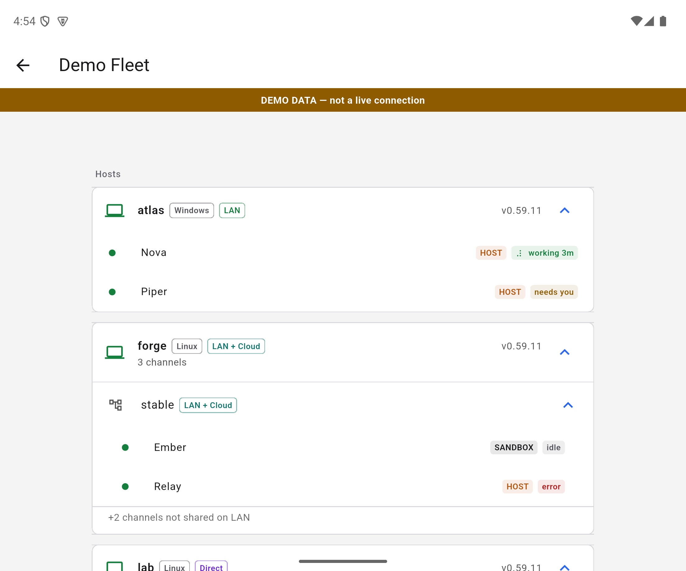

### Large text as built (5)

From a text scale of 1.5 up (iOS Dynamic Type from about AX1, Android's larger font sizes) a row stops being one line: a computer's version moves under its name, an agent's tags go on a line under its name, and a channel's tags wrap beneath it, so a name is never a letter per line. Fixed-size chrome stops growing at 1.5: the badges, the DEMO banner, the bottom sign-in button and the app-bar title (1.3). Below 360 dp wide, or at large text, the discovery bar's refresh button moves into the menu so the title is not cut ("Agen…"), and the bottom status shows "None" instead of a clipped "No com…" where its half is under 90 dp. Content text keeps growing and scrolls.

The capture below is a 320 dp window at the largest font (x3.1), where the same screen had a computer name one letter wide and its tag split into "L/A/N":

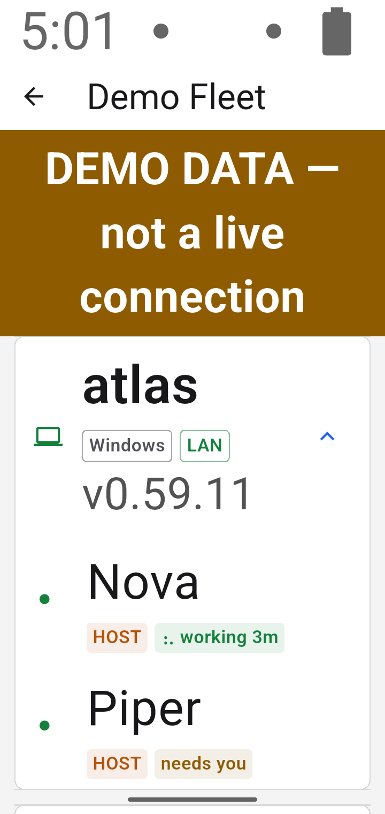
